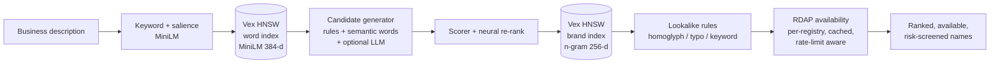

# DomainForge


Describe a business in one sentence and get **ranked, confirmed-available domain names**, each screened for **lookalike / phishing risk**. Search runs on **[Vex](https://github.com/AshuGuptaz/Vex)**, a from-scratch HNSW vector database used here as an embedded library, with **real neural embeddings (MiniLM via ONNX Runtime) running locally, no API key needed**.

Built as a GoDaddy-style problem: domain search, availability, and domain abuse in one backend.

## What it does

| Feature | How it works |
|---|---|
| **Semantic name ideas (neural, local)** | ~630 brandable words are embedded with **all-MiniLM-L6-v2** (384-dim, ONNX Runtime, in-process) and stored in a **Vex HNSW index**. Each salient keyword of the description is looked up by *meaning*: "coffee" retrieves brew, cup, cafe, mug, espresso, latte. Those words feed the name generator. |
| **Neural re-ranking** | Top candidates are re-scored by MiniLM cosine similarity between the name and the description, blended into the relevance score |
| **Rule-based generation** | Affixes, portmanteau blends, evocative industry words from a lexicon |
| **Ranking** | Transparent 0-100 score: length, pronounceability, cleanliness (no hyphens/digits), TLD value, relevance, minus a risk penalty. The full breakdown is returned. |
| **Real availability** | RDAP lookups straight to each registry (via the IANA bootstrap file), per-host concurrency cap, `Retry-After`-aware retry on 429, TTL cache, hard overall deadline. TLDs with no RDAP service return `UNKNOWN`, never a guess. |
| **Lookalike detection** | A second Vex index over character n-gram vectors retrieves candidate brands by *spelling*, then exact rules confirm: homoglyph skeletons (Cyrillic/Greek, `0->o`, `rn->m`, `1->l/i`), Damerau edit distance, brand + phishing keyword, mixed-script and punycode (IDN) decoding |
| **Optional generative LLM** | Any OpenAI-compatible endpoint (local Ollama, or a hosted free tier). Adds creative names, a one-line "why this works" per pick, and a plain-English explanation of risky domains. Off unless a model is configured. |

Two embedding spaces on purpose: **spelling vectors** answer "does this *look* like that brand?", **MiniLM vectors** answer "does this *mean* what the business does?".

## Architecture



## Pipeline

```
description -> keywords -> pick salient ones by meaning -> nearest words in Vex (MiniLM)
            -> candidates (rules + semantic words [+ LLM]) -> score + lookalike risk (Vex)
            -> neural re-rank -> drop near-duplicate labels
            -> RDAP availability in rounds (best TLD first, retry taken labels on next TLD)
            -> top N -> optional LLM rationale
```

Availability is checked in rounds rather than for every label x TLD pair: that cut lookups from ~60 to ~35 per request and avoids hammering registries.

## Run it

Requires Java 17+ and Maven. Vex must be in your local Maven repo first:

```bash
(cd ~/vex && mvn install -DskipTests)          # one-time: installs com.vex:vex-core
mvn spring-boot:run                              # http://localhost:8081
```

The first start downloads the embedding model (~90 MB, once) into `~/.cache/domain-forge`. After that it runs fully offline. If the download fails, semantic features switch off and the rest still works (`DOMAINFORGE_EMBEDDING=off` forces that).

Optional generative LLM (not required):

```bash
# local and free: install Ollama, `ollama pull qwen2.5:3b`, then
export DOMAINFORGE_LLM_MODEL=qwen2.5:3b
# or any hosted OpenAI-compatible endpoint
export DOMAINFORGE_LLM_URL=https://api.groq.com/openai/v1 DOMAINFORGE_LLM_KEY=... DOMAINFORGE_LLM_MODEL=<model id>
```

Offline / demo mode (deterministic fake availability, no network): `DOMAINFORGE_AVAILABILITY=mock`.

Docker: `docker build -t domain-forge . && docker run -p 8081:8081 domain-forge` (multi-stage build clones and builds Vex, and bakes the embedding model into the image). `docker compose up` also works; `--profile llm` adds a local Ollama.
Deploy: `render.yaml` is a Render blueprint. The JVM + ONNX model want about 1 GB RAM; on a 512 MB instance set `DOMAINFORGE_EMBEDDING=off`.
*Note: the Dockerfile, compose file and CI workflow have not been run end to end yet.*

## API

```bash
# ranked, available suggestions
curl -X POST localhost:8081/api/v1/suggest -H 'content-type: application/json' \
  -d '{"description":"specialty coffee shop in Lucknow","count":8,"tlds":["com","ai","in"]}'

# is this domain imitating a brand?
curl -X POST localhost:8081/api/v1/lookalike -H 'content-type: application/json' \
  -d '{"domain":"paypa1-secure-login.com"}'

curl "localhost:8081/api/v1/check?domain=example.com"   # availability + risk
curl "localhost:8081/api/v1/semantic?q=coffee&k=8"       # nearest words by meaning (Vex + MiniLM)
curl localhost:8081/api/v1/stats                         # latency p50/p99, cache, Vex index sizes
```

A small UI is served at `/`.

## Measured results

Full reports with methodology and error analysis: [`docs/EVAL.md`](docs/EVAL.md), [`docs/SCALE.md`](docs/SCALE.md), [`docs/DECISIONS.md`](docs/DECISIONS.md).

**Lookalike detection quality** (1,283 generated attacks across 12 types; 5,000 real legitimate domains from Tranco; 8,917 brands indexed in Vex)

| | |
|---|---|
| Attack recall | **97.3%** (correct brand named in 97.4% of flagged) |
| False positives on real domains | **2.4%** flagged, **1.0%** at HIGH only |
| False positives on product-style names | 1.2% |
| Baseline before tuning | recall 99.9%, but **21.4%** false positives. Fixed by brand tiers, TLD-aware severity and per-form rules (see DECISIONS.md) |

**Vex HNSW vs brute force** (real domain vectors, k=10)

| Vectors | HNSW p50 | Brute-force p50 | Speed-up | Recall@10 |
|---:|---:|---:|---:|---:|
| 10,000 | 0.45 ms | 1.9 ms | 4x | 0.994 |
| 100,000 | 0.63 ms | 20.0 ms | 32x | 0.967 |
| 200,000 | 0.95 ms | 40.4 ms | 43x | 0.953 |

**Other**
- Lookalike analysis in the running service: p50 **0.4 ms**, p99 **3.2 ms** (304 requests)
- Semantic index: 627 words embedded with MiniLM and inserted into Vex in ~1.3 s at startup
- `/suggest` with live RDAP: ~4-6 s cold, dominated by registry network round-trips
- 30 tests (28 run by default). Includes 3 that run the real MiniLM model through Vex. The evaluation and scale benchmarks are opt-in: `mvn test -Dtest='LookalikeEvalTest,ScaleBenchmarkTest' -Dforge.eval=true -DargLine="-Xmx4g -Dforge.eval=true"` (run `scripts/fetch_tranco.sh` first)

## Honest limitations

- **The shipped vocabulary is small** (~630 words) and the shipped brand list is 136 curated brands. The scale benchmark shows where Vex pays off (43x at 200k vectors); the evaluation ran with ~9k brands. Loading a larger production catalogue is not wired into the app yet.
- **Evaluation caveats:** attacks are synthetic and from the families the rules target; the "benign" set is real domains assumed legitimate (some are genuinely ambiguous). Recall is an upper bound, FPR is likely an over-estimate. Details in `docs/DECISIONS.md`.
- Whole-sentence queries embed noisily; per-keyword lookups with a similarity threshold work much better, so that's what the pipeline does. A few off-topic words still slip through (e.g. from place names).
- **The generative LLM path is tested against a stub endpoint only**; the neural embedding path is tested against the real model.
- `.io` and `.co` have no RDAP service in the IANA bootstrap, so they show `UNKNOWN`.
- Availability is "not registered right now", not a purchase guarantee. Premium and reserved names can be unregistered but unavailable.
- Availability cache and rate limiting are in-process. Production would use Redis, and Kafka for bulk jobs. Not implemented.

## Layout

```
gen/    Lexicon, RuleBasedGenerator, LlmNameGenerator, LlmClient, AiAdvisor
embed/  MiniLmEmbedder (ONNX Runtime), NgramEmbedder (spelling vectors)
avail/  RdapChecker, MockChecker, CachingChecker, BulkAvailabilityService
risk/   LookalikeDetector, Confusables, BrandCatalog
index/  VexIndex (adapter over com.vex.core.HnswIndex), SemanticSearch
rank/   NameScorer
api/    REST controller, SuggestionService, DTOs, latency recorder
```
