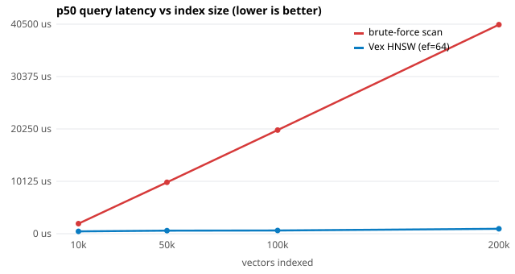

# Scale benchmark: Vex HNSW vs brute force

Generated 2026-11-14 by `ScaleBenchmarkTest`. Real domain labels from the Tranco list, 256-dim character n-gram vectors (cosine), 400 typosquat queries, k=10. HNSW: M=16, efConstruction=100, efSearch=64. Single thread, exact baseline is a straight scan with a top-k insertion buffer.

| Vectors | HNSW build | HNSW p50 | HNSW p99 | Brute p50 | Brute p99 | Speed-up (p50) | Recall@10 |
|---:|---:|---:|---:|---:|---:|---:|---:|
| 10,000 | 13.5 s | 452 us | 673 us | 1947 us | 2185 us | **4x** | 0.994 |
| 50,000 | 77.6 s | 597 us | 939 us | 9945 us | 12087 us | **17x** | 0.982 |
| 100,000 | 152.6 s | 629 us | 828 us | 20032 us | 21163 us | **32x** | 0.967 |
| 200,000 | 295.5 s | 945 us | 4973 us | 40403 us | 85996 us | **43x** | 0.953 |

**Reading the table**
- Brute-force cost grows linearly with the index; HNSW grows slowly. The crossover is early: already 4x faster at 10k vectors and 43x at 200k.
- Recall@10 falls from 0.994 to 0.953 because `efSearch` was held constant at 64. Raising it recovers recall at the cost of latency (the standard HNSW trade-off); it was not tuned here.
- The 200k HNSW p99 (about 5 ms) is a tail outlier on a laptop (likely GC / other processes); p50 is the stable number.
- The baseline is an unoptimised single-threaded scan in Java. A SIMD or multi-threaded scan would narrow the gap, so treat the speed-ups as relative to this simple baseline.
- Build is single-threaded: about 295 s for 200k vectors (efConstruction=100).
